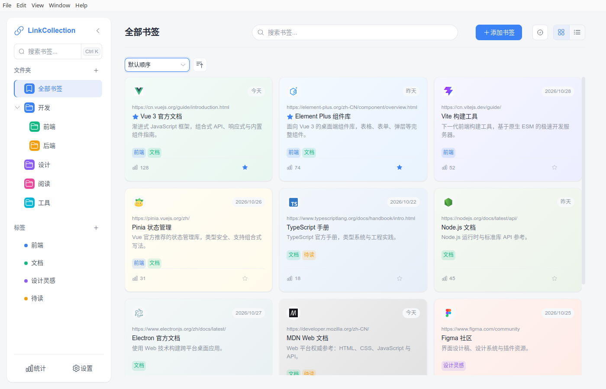
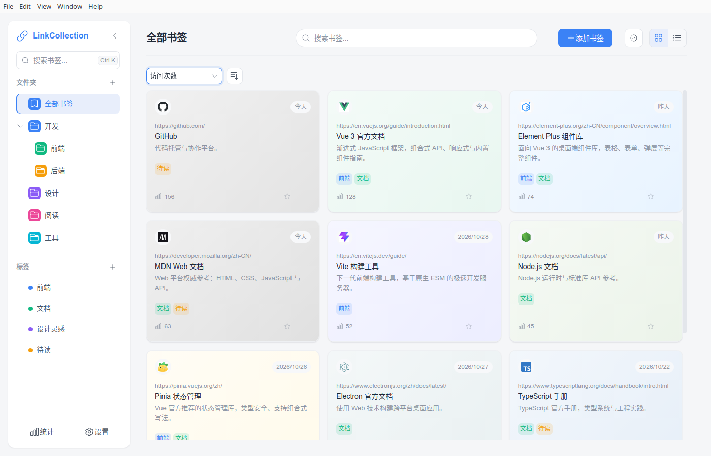
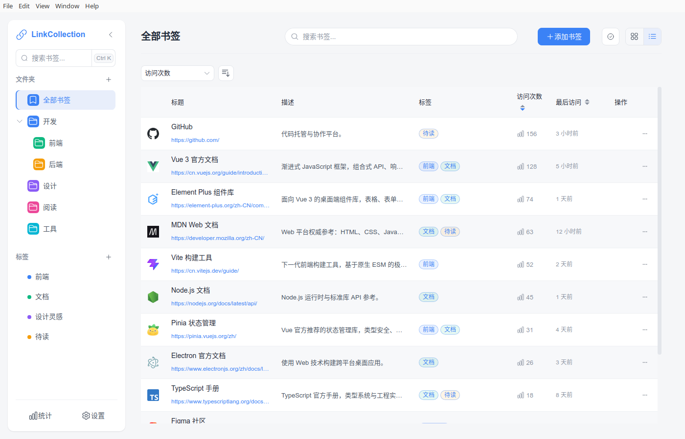
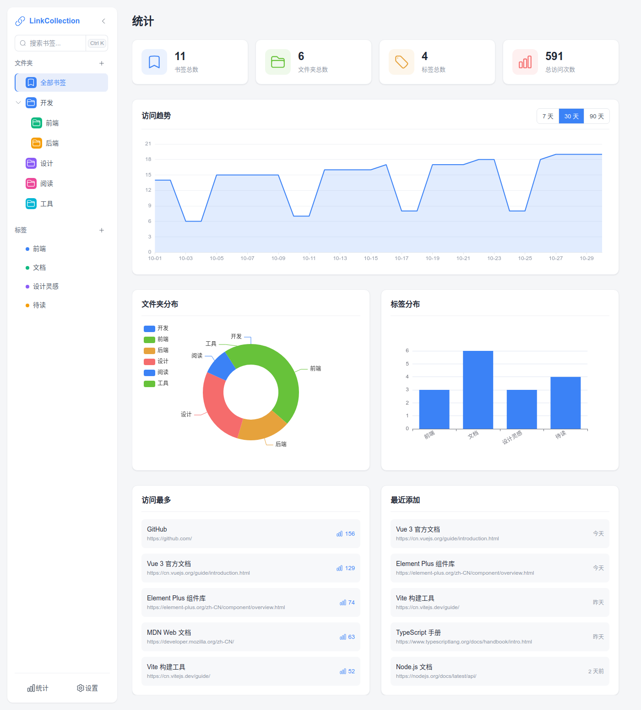
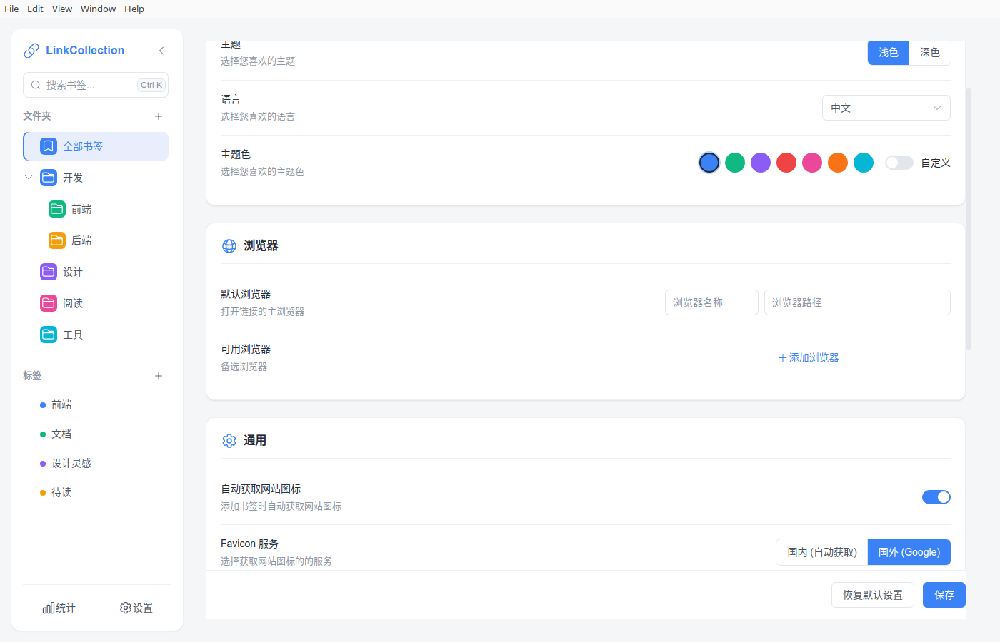

# LinkCollection

<div align="center">


**一个现代化的跨平台书签管理应用**

[功能特性](#-功能特性) • [截图](#-截图) • [快速开始](#-快速开始) • [快捷键](#-快捷键与托盘) • [数据存储](#-数据存储) • [技术栈](#-技术栈) • [路线图](#-路线图)

</div>

---

## ✨ 功能特性

### 📚 组织与检索

- **多级文件夹** - 文件夹支持任意层级，侧栏树形展示、可折叠；选中父文件夹即展示其整棵子树的全部书签
- **标签系统** - 多标签归类与筛选，标签可自定义颜色
- **书签置顶** - 星标一键置顶，置顶组恒定优先，不受当前排序规则影响
- **双视图 + 共享排序** - 卡片 / 列表自由切换，两视图共用同一套排序状态（标题、添加时间、访问次数、最近访问 × 升降序）
- **智能搜索** - 标题、URL、描述全文匹配，关键词高亮（HTML 已转义，安全渲染）
- **批量操作** - 多选后批量移动文件夹、追加/移除标签、统一改色、批量删除；批量动作在主进程一次读写完成
- **多浏览器打开** - 配置默认浏览器与备选浏览器，每张书签可从指定浏览器打开
- **访问追踪** - 记录访问次数与最近访问时间，支持按访问维度排序

### 🎨 界面

- **设计变量层** - 统一的 `--lc-*` 变量（间距、圆角、字号、语义色、阴影、动效），浅色/深色双套取值
- **主题** - 浅色 / 深色切换，外加 8 色主题色板与自定义取色，主题色会同步驱动主按钮、选中态与焦点环
- **国际化** - 中文 / 英文完整切换，表单校验、表格表头、确认弹窗均随语言变化
- **Favicon 服务** - 支持「直连站点 `/favicon.ico`」与「Google 图标服务」两套来源，国内外可分别配置
- **响应式布局** - 侧栏可折叠，卡片网格按窗口宽度 1–4 列自适应，空状态居中提示

### 🖥️ 桌面集成

- **系统托盘** - 托盘菜单可直接显示主窗口、呼出快速添加、跳转统计/设置、退出；关闭窗口默认收进托盘而不是退出
- **全局快捷键** - `Ctrl/Cmd+Shift+L` 呼出快速添加浮窗，`Ctrl/Cmd+Shift+O` 显示主窗口（无需先切到应用）
- **快速添加浮窗** - 460×190 无边框小窗，输入网址回车即存，保存后自动收起并让主窗口列表实时刷新
- **单实例** - 重复启动会聚焦已有窗口，不会开出两个托盘

### 📦 数据管理

- **本地 JSON 存储** - 人类可读、易于手工检查与迁移
- **原子写入** - 先写临时文件再 `rename` 替换，进程中断不会产生半个文件
- **损坏自愈** - JSON 解析失败或结构异常时自动备份为 `<name>.corrupt-<时间戳>.json`，不会静默覆盖
- **Schema 版本与迁移** - `meta.json` 记录数据版本，启动时按表驱动执行迁移；幂等、失败不推进版本
- **导入 / 导出** - JSON 与 Netscape HTML 双向支持；合并模式按文件夹名、标签名、归一化 URL 去重，id 重新映射，写入失败自动回滚
- **回收站** - 删除是**软删除**：书签进入回收站可随时恢复，也可永久删除或一键清空；
  超过 30 天（启动时）自动清理。单条删除、批量删除、重复合并丢弃的副本都走同一套软删除
- **重复书签合并** - 按归一化 URL 找出指向同一地址的书签，预览后一次合并：保留访问最多/已置顶的一条，
  标签取并集、访问次数求和、最近访问取最新，其余副本删除（http 与 https、不同 query 视为不同书签，避免误合并）
- **失效链接检查** - 一键批量探测全部书签（HEAD 优先、失败回退 GET，并发 4、单请求 8s 超时），
  结果分为「正常 / 失效 / 无法确定」三类并写入书签；可一键删除确认失效的链接
- **清空与重置** - 一键清空数据或恢复默认设置

### 📊 数据统计

- 书签 / 文件夹 / 标签 / 访问总量概览
- **访问趋势** - 每次打开书签都会记录一条访问历史，可按 7 / 30 / 90 天查看每日访问曲线
- 文件夹分布（环形图）、标签分布（柱状图），ECharts 渲染并跟随容器尺寸重绘
- 访问最多、最近添加两个榜单

### 🔒 安全

- **渲染进程沙箱** - `sandbox: true` + `contextIsolation: true` + 关闭 `nodeIntegration`
- **严格 CSP** - 生产环境 `script-src 'self'`（不含 `unsafe-eval`），并通过响应头与构建期 `<meta>` 双通道下发
- **无 eval 的 i18n** - vue-i18n 采用 JIT 编译（AST 解释执行），避免 `new Function` 被 CSP 拦截
- **外链白名单** - 打开浏览器仅接受 http(s)，浏览器路径必须在设置的可执行清单内且通过校验
- **导航拦截** - 禁止渲染进程创建新窗口，站外导航一律转交系统浏览器
- **写入白名单** - 所有 IPC 写接口按字段白名单合并，渲染层无法改写 `id` / `createdAt` 等主进程字段
- **XSS 防护** - 关键词高亮先按原文下标切分再逐段转义，只输出可信 `<mark>` 标签

---

## 📸 截图

### 主界面

侧栏为文件夹树与标签列表，顶栏含标题、搜索框、新建与视图切换按钮；卡片展示 favicon、标题、描述、标签、访问次数与置顶星标。



### 卡片视图（按访问次数排序）

卡片视图与列表视图共享同一个排序控件，切换视图后排序状态保持不变。



### 列表视图

表格形式展示描述、标签、访问次数、最近访问，表头点击可与上方排序控件双向同步。



### 统计页面

包含访问趋势折线图（可按 7 / 30 / 90 天切换）、文件夹与标签分布、访问最多与最近添加榜单。



### 设置页面

外观（主题、语言、主题色）、浏览器、通用（favicon 服务）、导入导出与数据管理。



---

## 🚀 快速开始

### 环境要求

- **Node.js**: v18 或更高版本
- **npm**: v8 或更高版本
- **操作系统**: Windows 10+ / macOS 10.15+ / Linux

### 安装

```bash
# GitCode（主仓库）
git clone https://gitcode.com/EthanCheung/LinkCollections

# 或 GitHub（镜像同步）
git clone https://github.com/EthanCheung-gh/LinkCollections

cd LinkCollections
npm install
```

> 若只想构建、不希望下载 Electron 二进制，可用 `npm install --ignore-scripts`。

### 开发模式

```bash
# 启动 Electron 开发服务器（含热更新）
npm run dev

# 仅启动 Web 开发服务器（纯浏览器预览，无法调用本地 IPC）
npm run dev:web
```

### 构建

```bash
# 编译主进程 / 预加载 / 渲染进程到 dist、dist-electron
npm run build

# 打包 Windows 安装包（NSIS + 便携版）
npm run build:win

# 打包 Linux 免安装目录（产物在 release/<version>/linux-unpacked）
npx electron-builder --linux dir

# 仅构建 Web 静态资源（产物在 dist-web，用于纯 Web 预览）
npm run build:web
```

构建产物输出到 `release/<version>/`（版本号取自 `package.json`）。

---

## ⌨️ 快捷键与托盘

| 操作 | 快捷键 |
| --- | --- |
| 呼出/收起快速添加浮窗 | `Ctrl/Cmd + Shift + L` |
| 显示并聚焦主窗口 | `Ctrl/Cmd + Shift + O` |
| 聚焦应用内搜索框 | `Ctrl/Cmd + K` |

- 关闭主窗口默认**收进托盘**（菜单里有「退出」）；若系统托盘不可用，关闭窗口会照旧退出，不会留下无窗口的进程。
- 托盘菜单：显示主窗口 / 快速添加书签 / 统计 / 设置 / 退出。
- 快捷键被其它程序占用时不会注册成功，应用照常启动（仅日志告警）；可用托盘菜单作为入口。

## 💾 数据存储

数据保存在 Electron 的用户数据目录下，应用名取自 `package.json` 的 `name`：

| 平台 | 路径 |
| --- | --- |
| Windows | `%APPDATA%\link-collection\data\` |
| macOS | `~/Library/Application Support/link-collection/data/` |
| Linux | `~/.config/link-collection/data/` |

```
data/
├── bookmarks.json   # 书签（含 pinned / folderId / tags / visitCount /
│                    #   deletedAt —— deletedAt 非空表示在回收站）
├── folders.json     # 文件夹（含 parentId，支持多级）
├── tags.json        # 标签
├── settings.json    # 主题、语言、浏览器、favicon 服务等
├── history.json     # 访问历史（每条 = 一次打开：bookmarkId + visitedAt）
└── meta.json        # 数据 schema 版本，用于启动时迁移
```

访问历史按「最近 90 天、最多 5000 条」自动裁剪，删除书签或清空数据时对应历史一并清理；"
replace 模式导入会重建全部数据，因此历史也会被清空（趋势从导入后重新累积）。

- 所有写入均为 **临时文件 + rename** 的原子替换；解析失败的文件会被备份成 `<name>.corrupt-<时间戳>.json` 后重建。
- 升级版本时，`meta.json` 中的 `schemaVersion` 决定需要执行哪些迁移；迁移失败不会推进版本，下次启动会重试。
- 想迁移机器或做备份，直接用设置页的「导出」或整体拷贝 `data` 目录即可。

---

## 🛠️ 技术栈

### 核心框架

- **[Electron](https://www.electronjs.org/)** - 跨平台桌面应用框架
- **[Vue 3](https://vuejs.org/)** - 渐进式 JavaScript 框架（组合式 API）
- **[TypeScript](https://www.typescriptlang.org/)** - 类型系统
- **[Vite](https://vitejs.dev/) / [electron-vite](https://electron-vite.org/)** - 构建与热更新

### UI & 样式

- **[Element Plus](https://element-plus.org/)** - Vue 3 组件库
- **[UnoCSS](https://unocss.dev/)** - 原子化 CSS 引擎
- **[Heroicons](https://heroicons.com/)** - 图标集（按需生成）

### 状态管理 & 数据

- **[Pinia](https://pinia.vuejs.org/)** - 状态管理（bookmark / folder / tag / ui / search / selection / sort）
- **[vue-i18n](https://vue-i18n.intlify.dev/)** - 国际化，JIT 编译以兼容严格 CSP
- **[ECharts](https://echarts.apache.org/)** - 统计图表
- **[uuid](https://github.com/uuidjs/uuid)** - 记录标识

### 其他

- **[lodash-es](https://lodash.com/)** - 实用函数
- **[ESLint](https://eslint.org/) + [Prettier](https://prettier.io/)** - 代码规范与格式化

---

## 📁 项目结构

```
LinkCollections/
├── electron/                     # 主进程
│   ├── main.ts                   # 入口：窗口、CSP、导航拦截、托盘、全局快捷键、启动迁移
│   ├── preload.ts                # contextBridge 暴露的 35 个 IPC 方法
│   ├── tray.ts / tray-icon.ts     # 托盘菜单（含纯函数模板）与内嵌图标
│   ├── quick-add.ts              # 快速添加浮窗（复用 index.html?view=quickadd）
│   ├── utils/
│   │   ├── storage.ts            # 原子读写 + 损坏备份
│   │   └── schema.ts             # schemaVersion 与表驱动迁移
│   └── ipc/
│       ├── bookmarks.ts          # 书签 CRUD + 访问计数 + 批量更新/删除
│       ├── folders.ts            # 文件夹 CRUD（多级、防环、删除时子级上提）
│       ├── tags.ts               # 标签 CRUD
│       ├── history.ts            # 访问历史（90 天 / 5000 条上限）
│       ├── links.ts              # 失效链接检查（HEAD→GET、并发 4、8s 超时）
│       ├── settings.ts           # 设置、打开浏览器（协议/路径白名单）
│       └── import-export.ts      # JSON / Netscape HTML 导入导出（去重、回滚）
├── src/renderer/                 # 渲染进程
│   ├── main.ts                   # 入口：按 ?view= 选择挂载 App.vue 或 QuickAdd.vue
│   ├── App.vue                   # 布局与视图切换
│   ├── QuickAdd.vue              # 快速添加浮窗的界面
│   ├── assets/styles/
│   │   ├── tokens.css            # --lc-* 设计变量（浅/深两套）
│   │   └── main.css              # reset、滚动条、Element Plus 变量映射
│   ├── components/
│   │   ├── Bookmark/             # CardView / ListView / BookmarkCard
│   │   │                         # SortControl / BulkActionBar
│   │   ├── Sidebar/              # 文件夹树、标签、搜索与历史
│   │   ├── Header/               # 标题、搜索、新建、选择模式、视图切换
│   │   ├── Modal/                # 增改书签 / 文件夹 / 标签
│   │   ├── Stats/                # 统计页（含访问趋势）
│   │   └── Settings/             # 设置页、导入导出、失效链接检查
│   ├── stores/                   # Pinia：bookmark / folder / tag / ui
│   │                             # search / selection / sort
│   ├── utils/                    # highlight（转义高亮）、validation、favicon
│   ├── locales/                  # en.json / zh.json
│   └── types/                    # 渲染层类型与 electronAPI 契约
├── tests/                       # vitest 单元测试（工具函数 / store / 主进程纯逻辑）
├── screenshots/                  # README 截图
├── electron.vite.config.ts        # 主进程/预加载/渲染进程构建 + CSP meta 注入
├── vite.config.ts                 # 纯 Web 预览/构建
├── package.json
└── README.md
```

---

## 📝 可用脚本

| 命令 | 描述 |
| --- | --- |
| `npm run dev` | 启动 Electron 开发服务器 |
| `npm run dev:web` | 仅启动 Web 开发服务器（浏览器预览） |
| `npm run build` | 构建主进程 / 预加载 / 渲染进程 |
| `npm run build:win` | 构建并打包 Windows 安装包 |
| `npm run build:web` | 构建纯 Web 静态资源到 `dist-web` |
| `npm run preview` | 预览 Web 构建产物 |
| `npm test` | 运行单元测试（vitest，单次） |
| `npm run test:watch` | 监听模式运行单元测试 |
| `npm run type-check` | TypeScript 类型检查（`vue-tsc --noEmit`） |
| `npm run lint` | ESLint 检查并自动修复 |
| `npm run format` | Prettier 格式化 `src/` |

---

## 🗺️ 路线图

### ✅ 已完成（v1.1.0）

- 书签 / 文件夹 / 标签管理与本地持久化
- 卡片视图、列表视图、全文搜索、访问统计与图表
- 深色主题、自定义主题色、中英文国际化
- favicon 服务切换与缓存、多浏览器打开
- 多级文件夹（树形侧栏 + 子树过滤）
- 书签置顶与置顶优先排序
- 批量选择：移动 / 打标签 / 改色 / 删除
- 两视图共享排序状态
- JSON / Netscape HTML 导入导出（去重、id 重映射、失败回滚）
- 数据 schema 版本与迁移框架
- 访问历史记录与统计页趋势图（7 / 30 / 90 天）
- 失效链接检查（HEAD/GET 探测、三类结果、批量清理）
- 重复书签合并（归一化 URL 分组、字段合并、一次性重写）
- 回收站（软删除、恢复、永久删除、30 天过期清理）
- 系统托盘、全局快捷键与快速添加浮窗（含自绘应用图标）
- 最小单元测试基建（vitest，覆盖工具函数、store 纯逻辑、主进程迁移与保留策略）
- 安全加固：渲染进程沙箱、严格 CSP、外链与写入白名单、XSS 转义

### 📋 计划中

- [ ] E2E 测试（组件渲染与 Electron 窗口行为）
- [ ] 自动更新
- [ ] 浏览器书签文件直读导入
- [ ] 云端同步与浏览器插件

---

## 🤝 贡献指南

欢迎贡献代码、报告问题或提出建议。

### 如何贡献

1. Fork 本仓库
2. 创建特性分支（`git checkout -b feature/AmazingFeature`）
3. 提交更改（`git commit -m 'Add some AmazingFeature'`）
4. 推送分支（`git push origin feature/AmazingFeature`）
5. 发起 Pull Request

### 开发规范

- 遵循 ESLint 配置，提交前跑一次 `npm run type-check`
- 样式统一使用 `--lc-*` 设计变量，不硬编码颜色、间距、圆角、字号
- 新增 IPC 通道需同步更新 `electron/preload.ts` 与 `src/renderer/types/global.d.ts`
- 修改数据结构需同时新增一条 schema 迁移（`electron/utils/schema.ts`）
- 新增纯逻辑（工具函数、store 计算、主进程辅助函数）请补 `tests/` 下的 vitest 用例
- 界面文案放入 `src/renderer/locales/{en,zh}.json`，保持两个语言键集一致

---

## 📄 许可证

本项目采用 MIT 许可证 - 详见 [LICENSE](LICENSE) 文件

---

## 🙏 致谢

感谢所有为这个项目做出贡献的开发者，以及以下开源项目：

- [Electron](https://www.electronjs.org/)
- [Vue.js](https://vuejs.org/)
- [Element Plus](https://element-plus.org/)
- [UnoCSS](https://unocss.dev/)
- [ECharts](https://echarts.apache.org/)
- [Heroicons](https://heroicons.com/)

---

## 📮 联系方式

- **作者**: Ethan Cheung
- **邮箱**: nirvana.zq@petalmail.com
- **GitCode**: [https://gitcode.com/EthanCheung/LinkCollections](https://gitcode.com/EthanCheung/LinkCollections)
- **GitHub**: [https://github.com/EthanCheung-gh/LinkCollections](https://github.com/EthanCheung-gh/LinkCollections)
- **问题反馈**: [Issues](https://gitcode.com/EthanCheung/LinkCollections/issues)

---

<div align="center">

**如果这个项目对你有帮助，请给它一个 ⭐️**

Made with ❤️ by Ethan Cheung

</div>

---

<div align="center">

## ☕ Buy Me a Coffee

如果这个项目对你有帮助，不妨请我喝杯咖啡！你的支持是我持续更新的动力 😊

</div>

<br>

<div align="center">

<table>
  <tr>
    <td align="center" style="padding: 20px; border: none;">
      
      <br>
      <strong style="font-size: 16px; margin-top: 10px; display: block;">支付宝</strong>
    </td>
  </tr>
</table>

<p align="center" style="margin-top: 20px;">
  <strong>感谢您的支持！</strong> 💜
</p>

<p align="center" style="font-size: 12px; color: #666; margin-top: 10px;">
  （微信打赏功能即将上线...）
</p>

</div>

---
